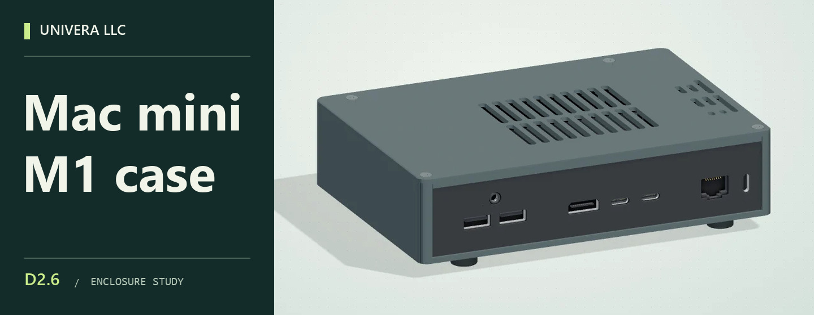

# Mac mini M1 enclosure

[](https://dvaderfun.github.io/mac-mini-m1-case-prototype/?view=rear)

An FDM enclosure for the **2020 Mac mini M1 logic board and its original heatsink**, developed by **Univera LLC**. The design explores passive cooling in a **170.00 × 119.91 × 46.00 mm** case with a removable rear panel and a separate USB-C power inlet. Those dimensions describe the CAD model.

**[Explore the case in 3D](https://dvaderfun.github.io/mac-mini-m1-case-prototype/?view=rear)** · **[Download the first-fit STL kit](cad/solidcraft-m1/prototype-d26/d2.6-first-fit.zip)** · **[Browse all CAD downloads](https://dvaderfun.github.io/mac-mini-m1-case-prototype/#downloads)**

## What D2.6 changes

The first printed D2.5 rear panel bowed near the USB-A ports and audio jack. D2.6 gives those three sockets one shared pocket behind the face and moves the face outward by 0.60 mm. The extra depth lets the panel hide the metal housings while leaving the plug openings accessible.

[](https://dvaderfun.github.io/mac-mini-m1-case-prototype/?view=inside)

The board sits on two supports. The rear panel slides into the empty base **before** the board goes in; the lid comes off independently. [Inspect the inner face of the panel](https://dvaderfun.github.io/mac-mini-m1-case-prototype/?view=rear&part=panel&solo=1&side=back) or [compare the D2.5 and D2.6 sections](https://dvaderfun.github.io/mac-mini-m1-case-prototype/d25-vs-d26-usb-audio-comparison.svg).

## Before printing

**D2.6 is ready for an unpowered fit check. Physical fit, powered operation, passive cooling and wireless performance have not been accepted.** The published CAD, STL and simulated toolpaths were checked. One detail still needs the real board: two reference models disagree about clearance at the shared Thunderbolt shield.

1. Start with the [small kit in this repository](cad/solidcraft-m1/prototype-d26/d2.6-first-fit.zip): rear panel **02**, power holder **01**, and samples **06–08**. For the panel, the checked PETG setup uses a 0.4 mm nozzle, 0.10 mm layers including the first, and no supports. The exterior face is already oriented toward the bed.
2. Fit the panel to the **unpowered** board. Check that it rests freely around the joined Thunderbolt shield and the audio jack. Compare each cable’s seating with and without the panel; try both USB-A plugs together and check that the Ethernet latch releases.
3. Print the full base and lid only after the panel, samples and board supports fit. Keep parts **01–04** and samples **06–08** together as one D2.6 revision. The [illustrated assembly view](https://dvaderfun.github.io/mac-mini-m1-case-prototype/d26-rear-assembly.jpg) and [detailed fit sheet, in Ukrainian](cad/solidcraft-m1/prototype-d26/FIT-FIRST.md), show the sequence.

## Select a file

| If you want to… | Use |
| --- | --- |
| Print the five enclosure parts after the first fit | [Full D2.6 STL kit](cad/solidcraft-m1/prototype-d26/d2.6-cold-fit-kit.zip) |
| Inspect solids in another CAD tool | [Printable parts · STEP](cad/solidcraft-m1/prototype-d26/d26-printable.step) or [mechanical assembly · STEP](cad/solidcraft-m1/prototype-d26/d26-assembly.step) |
| Edit the native design | [SolidCraft workbench](cad/solidcraft-m1/prototype-d26/d26-workbench.sc) |
| Inspect the board and heatsink reference | [GLB model](cad/solidcraft-m1/prototype-d26/board-study/mac-board-reference.glb). These meshes are in the GLB and native workbench; they are absent from the STEP files. |

## Work on the project

From a checkout, verify the frozen D2.6 files against their recorded hashes with Python:

```sh
python tools/verify_release.py
```

For engineering work, start in PowerShell 7 with `./project.ps1 doctor`. The [contributor guide](CONTRIBUTING.md) explains the checks and how to report a physical fit result. See the [source and license notices](THIRD_PARTY.md) before reusing board geometry or images.
