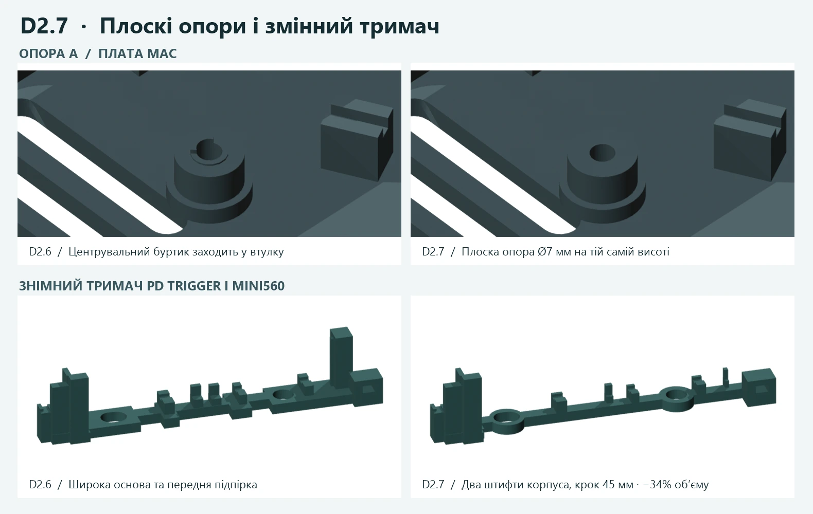
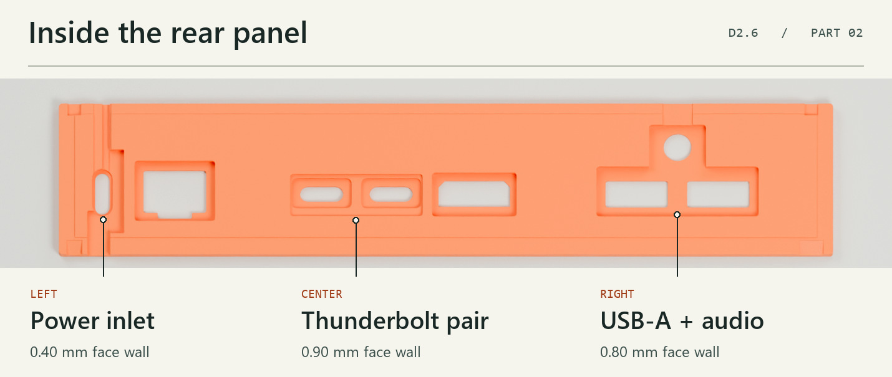

# Enclosure Lab

**A printable enclosure study for Mac mini (M1, 2020) · Univera LLC**

Keep the original logic board and heatsink. Print the parts around them. D2.7 is a **170 × 119.91 × 46 mm** enclosure with a removable lid, a separate USB-C power inlet and an eight-opening rear panel. It replaces the board locating collars with flat Ø7 mm seats. The simpler CMTPD and Mini-560 carrier uses the same two case pins, 45 mm apart, so another carrier can use the same base.

**[Explore the D2.7 3D model](https://univera-llc.github.io/m1-enclosure/)** &nbsp;·&nbsp; **[Download the first-fit kit · ZIP](https://univera-llc.github.io/m1-enclosure/downloads/d2.7/d2.7-first-fit.zip)** &nbsp;·&nbsp; **[Open the editable CAD](cad/solidcraft-m1/prototype-d27/d27-workbench.sc)**

[View the model offline](docs/VIEWER.md#local-viewer) · [D2.6 archive](https://univera-llc.github.io/m1-enclosure/d2.6/)

**Current status:** D2.7 passed digital geometry and slicing checks. A complete physical assembly has **not** been accepted. Use this release for an **unpowered fit check**. Power, button operation, passive cooling and wireless performance remain unverified.

## Print the small kit first

Start with the [20 mm calibration cube](cad/solidcraft-m1/calibration/calibration-cube-20mm.stl). Check that the slicer shows 20 mm on all three axes at 100%, then measure the cooled print. If its size is off, check the printer settings before printing the case.

1. **Unzip the [first-fit kit](cad/solidcraft-m1/prototype-d27/d2.7-first-fit.zip).** It contains a power holder (**01**), rear panel (**02**) and three samples (**06–08**) for the board supports, side guide and lid stop. Leave the full base and lid for later.
2. **Print the supplied STL orientations at 100%, in millimetres.** The checked Ender 3 Pro setup uses PETG, a 0.4 mm nozzle and no supports. Use **0.10 mm for every layer of the panel**, including the first. Its smooth outside face is already on the bed. The holder and samples use 0.20 mm layers.
3. **Try the parts without power.** Start with the flat support strip and power carrier. Then set the panel against the bare board and check for pressure on the common Thunderbolt shield. Compare your plugs with and without the panel. Check the guides and the Ethernet latch before printing the [five-part case](cad/solidcraft-m1/prototype-d27/d2.7-cold-fit-kit.zip). Align the ports before tightening the board screws.

[Step-by-step fit guide (English)](docs/guides/first-fit.md) · [Kit instructions (Українська)](cad/solidcraft-m1/prototype-d27/FIT-FIRST.md) · [Report a fit result](CONTRIBUTING.md#report-a-fit-result)

## Why this panel looks different

The first D2.5 panel bowed near the USB-A ports and audio jack. D2.7 keeps the D2.6 replacement panel unchanged. Here is its inside face:

The outer face moved **0.60 mm** outward. A shared T-shaped recess now clears the USB-A and audio housings in the photo-registered model while leaving **0.80 mm** of plastic in front of them. The Thunderbolt region deserves its own fit check: two digital references disagree about the common metal shield. [Compare D2.5 and D2.6](cad/solidcraft-m1/prototype-d26/d25-vs-d26-usb-audio-comparison.svg) or [read the numerical comparison](cad/solidcraft-m1/prototype-d26/reference-crosscheck.json).

## Choose a file

| To… | Open |
| --- | --- |
| Print the entire case after the first fit | [D2.7 full STL kit](cad/solidcraft-m1/prototype-d27/d2.7-cold-fit-kit.zip). Use D2.7 parts 01, 03, 04, 06 and 08. Parts 02, 05 and 07 are identical to D2.6. |
| Modify the design in CAD | [SolidCraft workbench](cad/solidcraft-m1/prototype-d27/d27-workbench.sc) · [printable parts STEP](cad/solidcraft-m1/prototype-d27/d27-printable.step) · [mechanical assembly STEP](cad/solidcraft-m1/prototype-d27/d27-assembly.step) |
| Inspect the board and heatsink | [Board reference · GLB](cad/solidcraft-m1/prototype-d27/board-study/mac-board-reference.glb). The STEP files contain mechanical solids; the board mesh is in the GLB and native workbench. |
| Reproduce a change | [CAD toolchain](docs/CAD-BUILD.md) · [viewer and browser checks](docs/VIEWER.md) · [contributor guide](CONTRIBUTING.md) |

To compare the files in your checkout with the published release, run `python tools/verify_release.py`. No CAD software is required for that check. [Current revision and paths](project.json) · [D2.7 file hashes](release/d2.7-manifest.json) · [D2.6 receipt](release/d2.6-manifest.json) · [plain-text index](llms.txt).

## Use and attribution

You can print your own case, adapt the design and share it free of charge under the [noncommercial project license](LICENSE). **Selling kits or cases, paid printing (even at cost) and other commercial uses require separate prior written permission from Univera LLC.** The logic-board and other third-party references retain their own [attribution and license terms](THIRD_PARTY.md).

Mac and Mac mini are trademarks of Apple Inc. Their use here identifies the intended hardware. Enclosure Lab is an independent project and is not affiliated with, sponsored by or endorsed by Apple.
